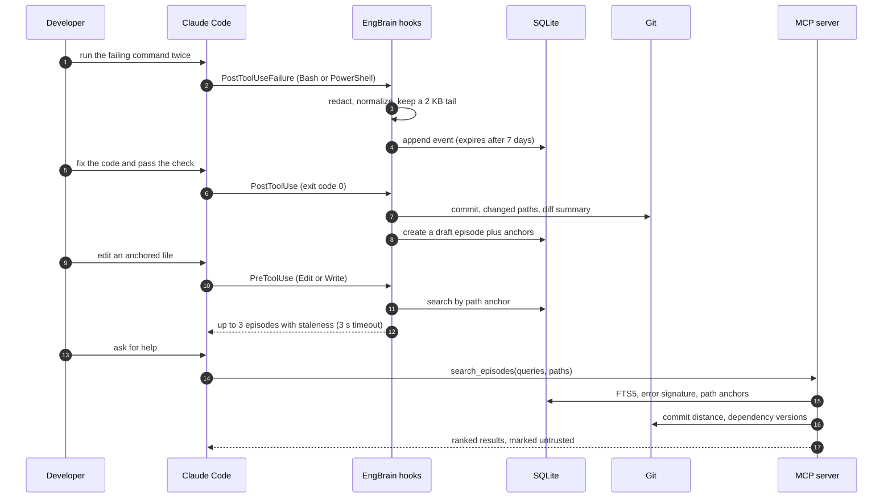
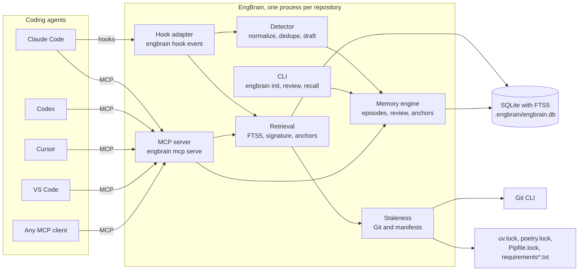
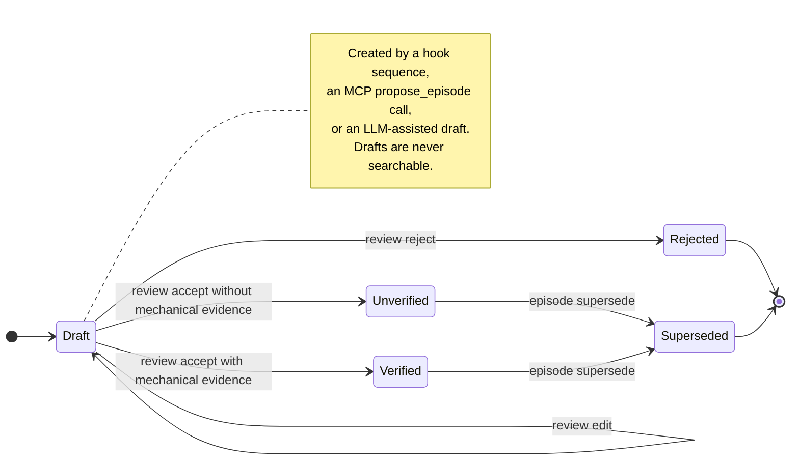
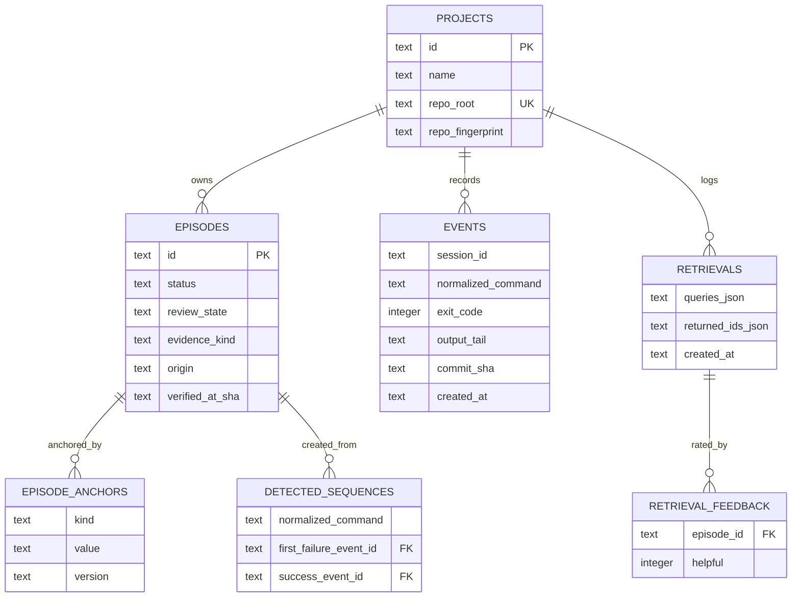

# EngBrain

**Local-first, evidence-graded engineering memory for AI coding agents.**

EngBrain records what actually happened while you debugged: the commands that failed, the attempts that did not work, the file and dependency anchors involved, and the evidence that the problem was eventually solved. An MCP server exposes those accepted episodes to Claude Code, Codex, Cursor, VS Code, or any other MCP client, and tells the agent whether the code behind each episode has changed since it was captured.

- **Local-first.** A SQLite database under `.engbrain/` in your repository. No hosted service, no account, no network call in the core.
- **Repository-scoped.** Every episode, event, and MCP operation belongs to one Git repository and one project row.
- **Evidence-graded.** Episodes carry `mechanical` evidence (observed command outcomes), `asserted` evidence (written by a person or agent), or none. Only a human acceptance turns mechanical evidence into `verified`.
- **Freshness-aware.** Anchors are re-checked against Git history and dependency manifests, so a stale note is labelled `drifted` or `stale` instead of being trusted silently.

Further reading: [BUILD_PLAN.md](BUILD_PLAN.md) for the design record and limitations, [EngBrain PRD v1.1](<EngBrain PRD v1.1.md>) for the requirements, [CONTRIBUTING.md](CONTRIBUTING.md) for repository invariants.

## Contents

- [The problem](#the-problem)
- [What an episode is](#what-an-episode-is)
- [How it works](#how-it-works)
- [Architecture](#architecture)
- [Requirements](#requirements)
- [Quick start](#quick-start)
- [Run it locally from a clone](#run-it-locally-from-a-clone)
- [Connect your coding agent](#connect-your-coding-agent)
- [MCP reference](#mcp-reference)
- [Command reference](#command-reference)
- [Evidence, anchors, and staleness](#evidence-anchors-and-staleness)
- [Demo repository](#demo-repository)
- [Showcase site](#showcase-site)
- [Evaluation](#evaluation)
- [Privacy and safety](#privacy-and-safety)
- [Known limitations](#known-limitations)
- [Development](#development)
- [License](#license)

## The problem

A debugging session produces exactly the knowledge an engineer needs six weeks later, and almost none of it survives the session. In practice that looks like this:

- The reasons behind a workaround live in one person's memory, or in a chat that has scrolled away.
- An agent repeats an approach that was already tried and already failed, because nothing recorded the failure.
- A note says "raise the connection pool", but the pool code was rewritten twice since then; the note still reads as authoritative.
- Design decisions have no proof attached, so nobody can tell an observed outcome from an opinion.

Transcripts are not a fix. They are large, noisy, contain secrets, and carry no notion of whether the advice still matches the repository.

EngBrain keeps the durable part of the session — problem, attempts, solution, evidence, anchors — and computes freshness from your repository instead of trusting a timestamp.

## What an episode is

An episode is one recovered engineering problem, stored as structured data rather than prose.

| Field | Meaning |
| --- | --- |
| `title`, `problem`, `context` | Short name, symptoms, and environment in which it happened |
| `episode_type` | `debugging`, `architecture_decision`, `dependency`, `deployment`, or `operational_gotcha` |
| `attempts` | What was tried, each with an optional command, exit code, and outcome |
| `solution_taken` | What ultimately worked |
| `rejected_alternatives` | Approaches that were ruled out |
| `verification_text` | How the result was checked |
| `error_signature` | Volatile identifiers, paths, and numbers normalized out, so similar failures match |
| `evidence_kind` | `mechanical`, `asserted`, or `none` |
| `evidence` | Observed commands, exit codes, diff summary, and a capture key |
| `status` | `unresolved`, `unverified`, `verified`, or `superseded` |
| `review_state` | `draft`, `accepted`, or `rejected` |
| `origin` | `hook`, `manual`, or `agent` |
| Anchors | `path`, `dependency` (with captured version), and `commit` |

Two rules follow from those fields and matter more than any other behavior in the project:

1. **Nothing unaccepted is searchable.** Drafts and rejected records stay out of every search path: CLI, hooks, and MCP.
2. **EngBrain never executes anything it retrieves.** Returned text is historical context, never instructions.

## How it works

1. **Capture.** Claude Code runs asynchronous hooks for `Bash` and `PowerShell` tool calls. Each event stores the redacted command, its exit code, and the last 2 KB of output. Events expire after seven days.
2. **Detect.** Two or more failures of the same normalized command in one session, followed by an exit-code-0 run, produce a draft episode with the observed attempts, a diff summary, and the commit at the passing run.
3. **Review.** A person runs `engbrain review`, inspects the draft, optionally edits it, and accepts or rejects it. Acceptance is the only path into search, and accepted mechanical evidence is the only path to `verified`.
4. **Recall.** Before an edit, a synchronous `PreToolUse` hook searches the file's path anchors and injects up to three matching episodes with freshness reasons. Agents can also call `search_episodes` over MCP at any time.
5. **Re-rank.** Search fuses FTS5 text matches, exact error signatures, and path anchors with reciprocal-rank fusion, then applies small bonuses and penalties for evidence quality and staleness.

## Architecture

The CLI, the MCP server, and the hook adapter are thin front ends over one Python engine. All three read and write the same per-repository SQLite database.

Each `MCP` edge is a stdio connection that spawns `engbrain mcp serve` inside the repository; the hook edge is a local subprocess call.

### Episode lifecycle

An accepted episode keeps its anchors, so its freshness can later be recomputed as `drifted` or `stale` without deleting anything. Superseding links the old record to its replacement: the old row remains inspectable but leaves search results.

### Storage

Episode text is mirrored into an FTS5 virtual table (`episodes_fts`, porter tokenizer) for search.

### Module map

| Module | Responsibility |
| --- | --- |
| `src/engbrain/cli.py` | Typer command surface: `init`, `doctor`, `status`, `episode`, `review`, `recall`, `feedback`, `eval`, `mcp`, `hook` |
| `src/engbrain/client_config.py` | Writes and inspects each client's MCP and hook configuration |
| `src/engbrain/hooks.py` | `PreToolUse` recall injection and `PostToolUse`/`PostToolUseFailure` capture |
| `src/engbrain/detector.py` | Command normalization, event retention, fail-fail-pass detection, draft creation |
| `src/engbrain/engine.py` | Episode create/get/list, review, supersede, anchor insertion |
| `src/engbrain/retrieval.py` | FTS5, error-signature, and anchor retrieval fused with reciprocal-rank fusion |
| `src/engbrain/staleness.py` | Commit distance, working-tree changes, dependency drift, freshness reasons |
| `src/engbrain/mcp_server.py` | `search_episodes`, `get_episode`, `propose_episode` over stdio |
| `src/engbrain/db.py` | Schema v3, WAL, FTS5 setup, integrity and migration checks |
| `src/engbrain/redaction.py`, `signatures.py` | Best-effort secret redaction, error-signature normalization |
| `src/engbrain/dependencies.py` | Reads lock and requirements files without importing project code |
| `src/engbrain/narrative.py` | Optional OpenAI-assisted draft (separate extra) |
| `src/engbrain/evaluation.py` | Bundled retrieval benchmark used by `engbrain eval` |

## Requirements

| Requirement | Notes |
| --- | --- |
| Python 3.11 or newer | CI covers 3.11 and 3.12 on Linux and Windows |
| Git command-line tools | Used for repository discovery, anchors, and staleness |
| SQLite with FTS5 | Required for search. `engbrain doctor` reports whether your interpreter's SQLite has it; some Linux distributions ship a `libsqlite3` without FTS5 |
| `uv` (recommended) or `pipx` | Only for installing and running the project |

Runtime dependencies are `typer`, `pydantic` v2, `tomlkit`, and the official MCP Python SDK. The `llm` extra adds `openai`; the `dev` extra adds `pytest`.

## Quick start

Install EngBrain once, from its own checkout:

~~~powershell
git clone https://github.com/arijitroy667/openfire.git
pipx install --editable .\openfire
~~~

Then initialize the repository you want it to remember:

~~~powershell
cd C:\work\my-project
engbrain init --client claude-code
engbrain doctor
engbrain status
~~~

`init` creates `.engbrain/engbrain.db` in that repository, adds `/.engbrain/` to the clone's `.git/info/exclude`, and writes the selected client's configuration. Without `--client` it still creates the database, which is enough when you only want the CLI or a client configuration you maintain yourself.

Run `engbrain doctor` after any client change: it reports Git discovery, database presence, SQLite FTS5 support, integrity, and whether each configured client can actually find the `engbrain` executable on `PATH`.

> The generated client configurations launch the bare `engbrain` command. If you installed with `uv sync` and only ever run `uv run engbrain ...`, the client's own process will not find it, and `engbrain doctor` will report `configured but engbrain is missing from PATH`. Install it with `pipx`, or activate the virtual environment before starting the agent.

## Run it locally from a clone

To work on EngBrain itself, or to run it without a global install:

~~~powershell
git clone https://github.com/arijitroy667/openfire.git
cd openfire

uv sync --extra dev

uv run engbrain init --client claude-code
uv run engbrain doctor
uv run engbrain status

uv run pytest -q
uv run engbrain eval
~~~

You can point `init` at any other repository instead:

~~~powershell
cd C:\work\my-project
uv run --project C:\work\openfire engbrain init --client codex
~~~

Each repository gets its own database and its own project row, keyed by the resolved repository path. A linked worktree is treated as a separate project with its own memory.

## Connect your coding agent

`engbrain init --client <name>` writes project-level configuration for one client. Run it again for other clients; files are merged rather than overwritten, and an `engbrain` entry that already belongs to a different command is reported instead of being clobbered.

| Client | Command | Files written | What the agent gets |
| --- | --- | --- | --- |
| Claude Code | `init --client claude-code` | `.mcp.json`, `.claude/settings.local.json` | MCP tools, automatic command capture, pre-edit recall |
| Codex | `init --client codex` | `.codex/config.toml` | MCP tools |
| Cursor | `init --client cursor` | `.cursor/mcp.json` | MCP tools |
| VS Code | `init --client vscode` | `.vscode/mcp.json` | MCP tools |
| Anything else | `init` (no client) | none | MCP tools via manual configuration |

All four generated entries use stdio and launch the same server program, `engbrain mcp serve --root <repository>`, so the server is scoped to the repository it was started in.

### Claude Code

~~~powershell
engbrain init --client claude-code
~~~

This writes two files and adds no new dependencies to Claude Code itself:

- `.mcp.json` registers a stdio server named `engbrain` with `args: ["mcp", "serve", "--root", "${CLAUDE_PROJECT_DIR:-.}"]`.
- `.claude/settings.local.json` gains three hook entries, merged into any hooks you already have:

| Event | Matcher | Mode | Timeout | Effect |
| --- | --- | --- | --- | --- |
| `PostToolUse` | `Bash` or `PowerShell` | async | 10 s | Records a successful command event |
| `PostToolUseFailure` | `Bash` or `PowerShell` | async | 10 s | Records a failed command event |
| `PreToolUse` | `Edit` or `Write` | sync | 3 s | Injects up to 3 anchored episodes as context, then lets the edit proceed |

The pre-edit hook returns `hookSpecificOutput.additionalContext` capped at 7,000 characters. It fails open: if the repository is not initialized, if the file is `.env`, a private key, or a certificate, or if nothing matches, it returns no context and the edit happens unchanged. Because it is synchronous, its 3-second budget is the only latency the agent can observe.

Restart Claude Code after the first `init` so the MCP server is spawned and project hooks are loaded.

### Codex

~~~powershell
engbrain init --client codex
~~~

Adds a project entry to `.codex/config.toml`, preserving existing formatting:

~~~toml
[mcp_servers.engbrain]
command = "engbrain"
args = ["mcp", "serve", "--root", "."]
cwd = "."
~~~

Codex loads project-level configuration for trusted projects, so approve the directory once. Codex has no EngBrain hooks in this release: it can search and propose episodes, but nothing is captured automatically. See the [Codex MCP documentation](https://developers.openai.com/codex/mcp).

### Cursor

~~~powershell
engbrain init --client cursor
~~~

Writes `.cursor/mcp.json`:

~~~json
{
  "mcpServers": {
    "engbrain": {
      "type": "stdio",
      "command": "engbrain",
      "args": ["mcp", "serve", "--root", "${workspaceFolder}"]
    }
  }
}
~~~

Restart or reload Cursor, then approve the server when prompted. See the [Cursor MCP documentation](https://cursor.com/docs/mcp).

### VS Code

~~~powershell
engbrain init --client vscode
~~~

Writes `.vscode/mcp.json`, which uses `servers` rather than `mcpServers`:

~~~json
{
  "servers": {
    "engbrain": {
      "type": "stdio",
      "command": "engbrain",
      "args": ["mcp", "serve", "--root", "${workspaceFolder}"]
    }
  }
}
~~~

See the [VS Code MCP documentation](https://code.visualstudio.com/docs/agent-customization/mcp-servers).

### Any other MCP client

Any client that can launch a stdio MCP server works. Register:

~~~json
{
  "mcpServers": {
    "engbrain": {
      "type": "stdio",
      "command": "engbrain",
      "args": ["mcp", "serve", "--root", "C:/work/my-project"]
    }
  }
}
~~~

Use an absolute path when the client does not expand workspace variables. To check the server by hand, run `engbrain mcp serve --root .` inside the repository: it speaks JSON-RPC over stdio and prints nothing else, which is the expected behavior for a stdio server.

## MCP reference

Three tools, all scoped to the repository the server was started in. Search and lookup results carry `"untrusted": true`.

| Tool | Parameters | Returns |
| --- | --- | --- |
| `search_episodes` | `queries` (1–5 strings), `paths` (optional), `episode_type` (optional), `limit` (default 5, capped at 5) | Ranked summaries with status, evidence kind, staleness, reasons, anchors, and `match_reason` |
| `get_episode` | `episode_id` | Full episode, anchors, staleness level and reasons, provenance |
| `propose_episode` | `title`, `episode_type`, `problem`, optional `context`, `attempts`, `solution`, `evidence_text`, `paths` | The new draft's `id`, `review_state`, `status` |

Notes that matter when you write agent instructions:

- `search_episodes` searches **accepted** episodes only; `propose_episode` creates a **draft** that a human must accept before it is visible to search.
- Agent proposals are recorded with `origin=agent` and can never claim mechanical evidence.
- Event output tails are never returned over MCP, only in the local database.
- Server instructions tell the client to treat every returned string as untrusted historical context and to verify against the current repository before acting.

## Command reference

### Setup and health

| Command | Purpose |
| --- | --- |
| `engbrain init [--name NAME] [--client none\|claude-code\|codex\|cursor\|vscode]` | Create the local database and optionally configure one client |
| `engbrain doctor` | Check Git, database, FTS5, integrity, and client wiring |
| `engbrain status` | Show the project id, episode count, drafts awaiting review, and database path |
| `engbrain --version` | Print the installed version |

### Capture and review

| Command | Purpose |
| --- | --- |
| `engbrain review` | List drafts awaiting review (id, origin, title) |
| `engbrain review accept EPISODE_ID` | Accept a draft; mechanical evidence becomes `verified` |
| `engbrain review reject EPISODE_ID` | Reject a draft while keeping its record locally |
| `engbrain review edit EPISODE_ID [--title] [--problem] [--context] [--solution] [--verification]` | Correct a draft before deciding |

### Episodes

| Command | Purpose |
| --- | --- |
| `engbrain episode create` | Write an episode by hand (`--title`, `--problem`, `--type`, `--context`, `--attempt`, `--path`, `--dependency`, `--solution`, `--verification`) |
| `engbrain episode draft --notes "..."` | Optional LLM-assisted draft; requires the `llm` extra |
| `engbrain episode list [--limit] [--review-state] [--status]` | List episodes with status, review state, and type |
| `engbrain episode show EPISODE_ID` | Full episode, evidence, anchors, and computed staleness |
| `engbrain episode supersede OLD --with NEW` | Mark an accepted episode replaced by another accepted one |

Manual episodes are accepted immediately but remain `unverified`; only observed command outcomes can earn `verified`.

### Search, feedback, and evaluation

| Command | Purpose |
| --- | --- |
| `engbrain recall --query "..." [--query "..."] [--path FILE] [--type TYPE] [--limit N]` | Search accepted episodes; 1–5 phrasings, limit capped at 5 |
| `engbrain feedback EPISODE_ID helpful\|not-helpful` | Store a local helpfulness mark for a recent result |
| `engbrain eval [--dataset FILE] [--json]` | Measure Recall@5, MRR, Precision@5, and p95 latency |

### Server and internals

| Command | Purpose |
| --- | --- |
| `engbrain mcp serve [--root PATH]` | Run the stdio MCP server for one repository |
| `engbrain hook event` | Internal adapter: reads a Claude Code hook payload from stdin |

### A realistic session

~~~powershell
engbrain init --client claude-code

# capture, then review what the agent produced
engbrain review
engbrain review edit EPISODE_ID --solution "Raised the pool limit to 4" --verification "check_pool.py passes"
engbrain review accept EPISODE_ID

# search it later, with more than one phrasing
engbrain recall --query "connection pool exhausted" --query "workers cannot get a connection" --path src/pool.py

# record whether the result was useful
engbrain feedback EPISODE_ID helpful
~~~

## Evidence, anchors, and staleness

### Evidence grading

| Kind | Produced by | Becomes `verified` when |
| --- | --- | --- |
| `mechanical` | Hook-detected fail-then-pass sequences | A human accepts it and the stored evidence contains an exit code of 0 |
| `asserted` | Agent proposals that supply `evidence_text` | Never automatically |
| `none` | Manual entries, agent proposals without evidence | Never automatically |

A fail-then-pass sequence is evidence that the observed outcome changed. It is not proof that a particular edit caused the change, and the generated `verification_text` says so.

### Anchors

| Anchor | Captured from | Used for |
| --- | --- | --- |
| `path` | Changed or untracked files since the first failure's commit (max 50, sensitive paths skipped) | Pre-edit matching, anchor search |
| `dependency` | Names mentioned in the command or error text, resolved through the local manifest snapshot | Dependency drift detection |
| `commit` | The commit at the passing run | Commit-distance staleness |

Recognized manifest sources: `uv.lock`, `poetry.lock`, `Pipfile.lock`, `requirements*.txt`, and pinned entries in `pyproject.toml`.

### Staleness

| Level | Meaning |
| --- | --- |
| `fresh` | Anchors exist and Git reports no changes touching them |
| `drifted` | Anchored paths changed in the working tree, or 1–19 commits touched them, or a dependency changed within the same major version |
| `stale` | An anchored path was deleted or renamed, 20 or more commits touched the anchors, a dependency was removed, or a dependency changed major version |
| `unknown` | Anchors are missing, or Git history, a capture commit, a pinned version, or a working-tree read is unavailable |

Every result carries human-readable reasons, for example `3 commit(s) touched anchored paths since capture` or `Dependency urllib3 remains at 1.26.18`.

### Ranking

Search runs three candidate lists — FTS5 `bm25` over episode text, exact normalized error signature, and path anchor equality — and fuses them with reciprocal-rank fusion (`k = 60`). Small adjustments then apply: `+0.002` for an error-signature match, `+0.001` for a path-anchor match, `-0.0005` for unverified episodes, and small penalties as staleness worsens. Superseded and draft episodes never enter the candidate set. The result set is truncated to five.

## Demo repository

[`examples/demo-repo`](examples/demo-repo/README.md) reproduces three deterministic incidents, each with a failing check, a one-line fix, and an anchor to watch:

| Incident | Check | Fix |
| --- | --- | --- |
| Connection pool exhaustion | `python scripts/check_pool.py` | Raise `MAX_CONNECTIONS` to 4 |
| Dependency pin mismatch | `python scripts/check_dependency.py` | Align the runtime bound with the pinned `urllib3` |
| Empty environment-variable value | `python scripts/check_runtime_flag.py` | Return `bool(value)` instead of `value is not None` |

Two ways to run it:

- **With Claude Code.** Copy the fixture outside this checkout, initialize it as its own Git repository, run each check twice so the hooks see failures, apply the fix, and run it once more. The hooks produce a draft; `engbrain review accept` publishes it.
- **Without a client.** `python scripts/offline_demo.py capture all` replays the same hook payloads, and `python scripts/offline_demo.py drift <pool|dependency|flag>` moves an accepted episode from `fresh` to `drifted` or `stale`.

The step-by-step recording plan, including the ordering that keeps an accepted episode `fresh`, is in [VIDEO_DEMO.md](examples/demo-repo/VIDEO_DEMO.md). The incident catalogue is in [examples/incidents](examples/incidents/README.md).

## Showcase site

[`site/`](site/README.md) is a static frontend for the product: a landing page and the documentation, sharing one light glassmorphic design system with no build step. Animations run on Framer Motion's `motion` engine, bundled locally as `site/assets/vendor/motion.js`; under reduced motion the page falls back to a fully static layout.

~~~powershell
python -m http.server 8765
~~~

Open <http://127.0.0.1:8765/site/index.html>. The landing page embeds `site/assets/showcase.mp4`, so serve over HTTP rather than opening the files directly. Palette, typography, and motion are documented in [`site/DESIGN.md`](site/DESIGN.md).

## Evaluation

### Retrieval fixture

~~~powershell
engbrain eval
engbrain eval --json
~~~

The bundled corpus has 12 synthetic target episodes, 30 synthetic distractors, and 24 queries. One recorded local run produced:

| Query set | n | Recall@5 | MRR | Precision@5 |
| --- | ---: | ---: | ---: | ---: |
| Lexical | 12 | 1.000 | 1.000 | 0.200 |
| Paraphrase | 12 | 0.750 | 0.542 | 0.150 |

These are measurements of a small synthetic fixture. They say nothing about public-issue retrieval quality or agent behavior. The corpus format and metric definitions are in [eval/README.md](eval/README.md); a custom corpus can be passed with `--dataset`.

### Codex agent study

A separate study ran 72 Codex sessions over twelve fixtures (five derived from public issues, seven synthetic), half with EngBrain memory and half without. Independent verification passed in 34/36 control runs and 36/36 memory runs. Median tool calls to pass were 5 for control and 7 with memory, so this study did **not** show a tool-call reduction. See [eval/codex/README.md](eval/codex/README.md) and the [full results](eval/codex/results-20261026.md). These sessions exercise the MCP tools, not the Claude Code hooks.

### Frozen retrieval challenge

A separate frozen challenge uses the same incidents with 36 lexical, paraphrase, and symptom queries. The lexical-only retriever reached Recall@5 of 1.00 on paraphrase and symptom queries, which is why semantic embeddings are not implemented. Limits are documented in [eval/retrieval/results-v1.md](eval/retrieval/results-v1.md); a bounded follow-up on real upstream issues is in [eval/upstream](eval/upstream/README.md).

## Privacy and safety

- **Local by default.** The database lives in `.engbrain/` and is excluded from Git for this clone. There is no telemetry, sync, or remote database.
- **Redaction before storage.** Hook text passes through best-effort patterns for private keys, provider tokens (`sk-`, `ghp_`, `github_pat_`, `AKIA`), bearer tokens, credential assignments, credentials embedded in URLs, and long high-entropy values.
- **Excluded commands.** Environment dumps (`env`, `printenv`, `Get-ChildItem Env:`) and commands touching secret files other than `.env.example`, `.env.sample`, and `.env.template` are dropped. Add your own with `ENGBRAIN_EXCLUDE_COMMANDS="comma,separated,substrings"`.
- **Bounded retention.** The event buffer keeps the last 2 KB of output per event and deletes anything older than seven days.
- **Untrusted output.** Every MCP result sets `"untrusted": true`, and the server instructions tell the agent to treat episode text as history rather than instructions. EngBrain does not execute retrieved commands.
- **Review gate.** Nothing reaches an agent until a person accepts it.

Redaction is best-effort, not a security boundary. Inspect drafts before accepting them, and do not point the hook at repositories whose terminal output you cannot afford to store locally.

## Known limitations

- Redaction covers common secret formats but cannot guarantee removal of every sensitive value.
- Hook capture supports documented Claude Code `Bash` and `PowerShell` payloads. It never blocks or rewrites a tool call.
- Only Claude Code receives automatic capture and pre-edit recall. Codex, Cursor, and VS Code get MCP tools and must be told by their instructions when to search.
- A fail-then-pass sequence does not attribute the pass to a specific edit.
- Staleness is `unknown` when Git history is unavailable, the capture commit is gone, or no supported manifest pins a version.
- Retrieval is lexical plus error signatures and anchors; paraphrase recall is not guaranteed and embeddings are deliberately absent.
- Data is local and project-scoped. There is no team sync, dashboard, or remote database.
- The pre-edit hook matches Claude Code's `Edit` and `Write` tools only. Other clients can pass `paths` explicitly.
- LLM drafting is optional, requires the `llm` extra plus `OPENAI_API_KEY` (and optionally `ENGBRAIN_OPENAI_MODEL` or `--model`), and sends redacted notes to OpenAI only when you run `engbrain episode draft`.

## Development

~~~powershell
uv sync --extra dev
uv run pytest -q
uv run engbrain eval
~~~

The suite builds isolated temporary repositories and databases; 39 tests run at this revision. CI runs the same suite on Python 3.11 and 3.12 on Ubuntu and Windows (`.github/workflows/ci.yml`).

Repository invariants, including why agent proposals cannot self-verify and why retrieved text is never executed, are in [CONTRIBUTING.md](CONTRIBUTING.md). The build record, including deferred work such as embeddings, is in [BUILD_PLAN.md](BUILD_PLAN.md).

## License

Proprietary. EngBrain is published for transparency and security review only; no right to install, run, modify, distribute, or embed it is granted by this repository. Any use, including internal and non-commercial use, requires a paid commercial license. Terms are in [LICENSE](LICENSE); licensing enquiries go to <arijitroy0445@gmail.com>. Bundled third-party components keep their own licenses, listed in [THIRD_PARTY_NOTICES.md](THIRD_PARTY_NOTICES.md).
